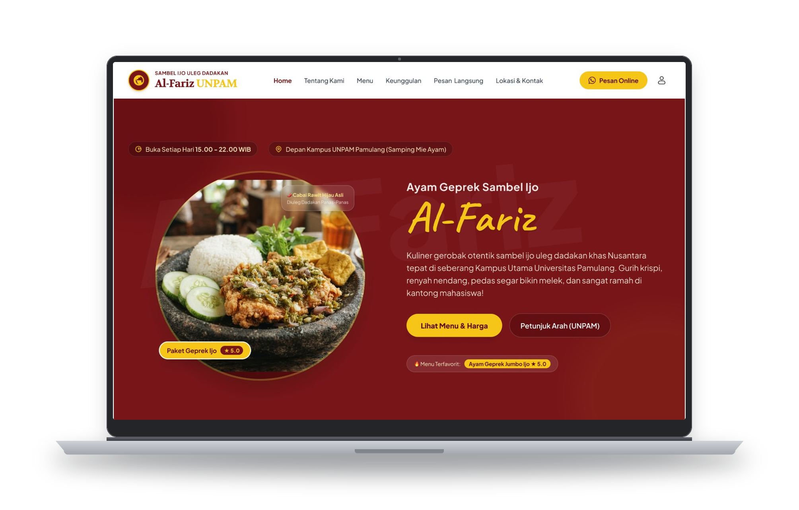
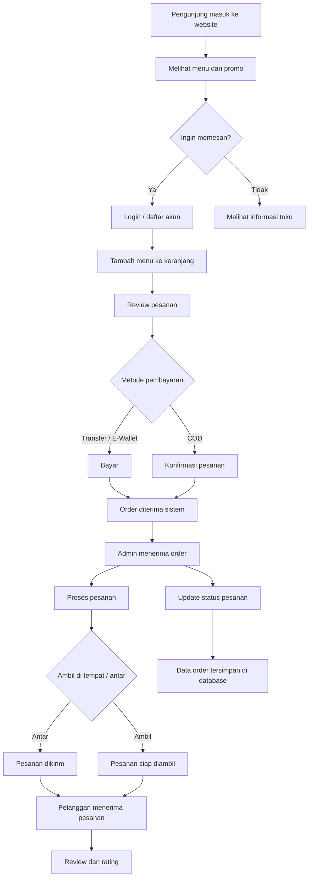
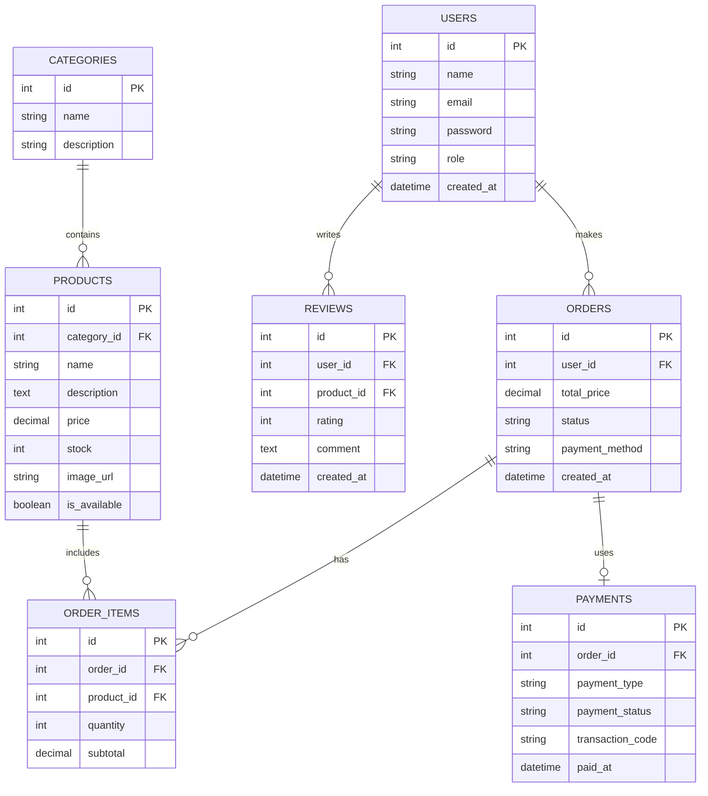
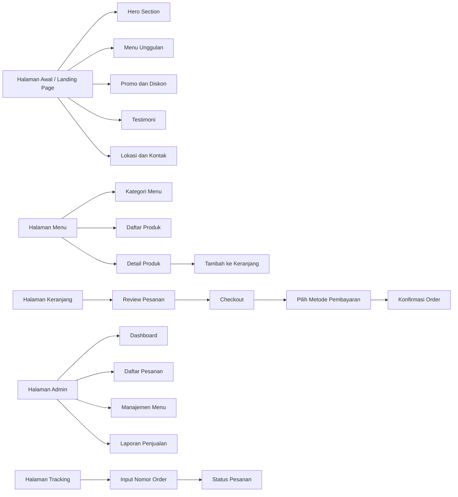

# Ayam Penyet Sambel Ijo Al-Fariz


<p align="center">
  <a href="[https://your-live-demo-url.com](https://ayamsambelijopamulang.my.id)">
    
  </a>
  <a href="https://github.com/oddycosplay/ayamgeprekpamulang/tree/main">
    
  </a>
  <a href="https://wa.me/6281234567890">
    
  </a>
  
  
  
  
  
  
  
</p>

[](https://ayamsambelijopamulang.my.id)
[](https://github.com/oddycosplay/ayamgeprekpamulang)
[](https://wa.me/628973816530)


---

## 1. Gambaran Umum Proyek

Proyek ini merupakan pengembangan website dan sistem operasional digital untuk UMKM kuliner Ayam Penyet Sambel Ijo Al-Fariz yang berlokasi di Pamulang, Tangerang Selatan. Tujuan utama dari pengembangan ini adalah meningkatkan visibilitas usaha di dunia digital, mempermudah proses pemesanan, serta mendukung pengelolaan operasional usaha secara lebih efisien.

Website yang dibangun tidak hanya berfungsi sebagai media promosi, tetapi juga sebagai kanal transaksi digital yang memungkinkan pelanggan melakukan pemesanan dengan cepat, melihat menu, menilai produk, dan menerima informasi mengenai status pesanan secara real-time.

---

## 2. Latar Belakang dan Tujuan

UMKM kuliner memiliki kebutuhan untuk bertransformasi dari model penjualan konvensional menuju sistem digital agar dapat bersaing dan berkembang di era teknologi. Berdasarkan kebutuhan tersebut, website ini dirancang untuk:

- Menampilkan identitas usaha dan profil bisnis secara profesional.
- Menyajikan katalog menu secara rapi dan mudah dipahami.
- Memfasilitasi proses pemesanan melalui platform digital.
- Mengintegrasikan komunikasi order ke WhatsApp agar lebih praktis.
- Menyediakan panel admin untuk mengelola pesanan, menu, dan laporan penjualan.
- Meningkatkan pengalaman pelanggan melalui tampilan modern dan responsif.

---

## 3. Ruang Lingkup Sistem

Sistem yang dikembangkan mencakup beberapa komponen utama, yaitu:

- Portal pelanggan
- Modul katalog menu
- Modul keranjang dan checkout
- Modul transaksi dan pembayaran
- Modul pengelolaan pesanan oleh admin
- Modul tracking status pesanan
- Modul ulasan dan testimoni
- Integrasi AI untuk rekomendasi dan interaksi pelanggan

---

## 4. Flowchart Sistem



---

## 5. Sistem Usulan

### 5.1 Fitur Utama

- Landing page dengan hero section, menu unggulan, promo, testimoni, dan lokasi usaha
- Katalog produk yang mencakup nama menu, harga, deskripsi, dan foto
- Keranjang belanja dan proses checkout
- Opsi metode pembayaran seperti COD, transfer, dan e-wallet
- Tracking status pesanan dari menunggu hingga selesai
- Panel admin untuk mengelola menu, pesanan, dan laporan
- Integrasi WhatsApp untuk komunikasi dan konfirmasi order
- Fitur ulasan pelanggan untuk meningkatkan kepercayaan publik

### 5.2 Arsitektur Sistem

Berdasarkan komposisi repository yang mayoritas berupa TypeScript, solusi yang paling sesuai adalah menggunakan pendekatan modular berbasis web modern:

- Frontend: Next.js + TypeScript
- Backend: Node.js + Express atau API route berbasis Next.js
- Database: PostgreSQL / MySQL
- Manajemen data: relasional database untuk transaksi dan catalog menu
- Penyimpanan media: sistem upload gambar produk dan promosi
- Integrasi eksternal: WhatsApp API, payment gateway, dan layanan AI

### 5.3 Modul utama

- User Module
  - Registrasi dan login
  - Profil pengguna
  - Riwayat pemesanan

- Product Module
  - Manajemen kategori menu
  - Tambah, ubah, dan hapus produk
  - Pengaturan stok dan harga

- Order Module
  - Pembuatan transaksi
  - Pemantauan status order
  - Log pesanan

- Payment Module
  - COD
  - Transfer bank
  - E-wallet

- Admin Module
  - Dashboard penjualan
  - Laporan harian dan bulanan
  - Manajemen pelanggan dan pesanan

---

## 6. ERD (Entity Relationship Diagram)



---

## 7. Wireframe UI

Berikut gambaran struktur antarmuka pengguna yang diusulkan:



### 7.1 Deskripsi Wireframe

- Halaman utama menampilkan brand awareness, hero banner, promo, dan informasi usaha
- Halaman menu menampilkan daftar produk berdasarkan kategori
- Halaman detail produk menampilkan foto, deskripsi, pilihan rasa/porsi, dan tombol tambah ke keranjang
- Halaman checkout menginformasikan total pembayaran, metode pembayaran, dan data pengiriman
- Halaman admin memungkinkan owner mengelola menu, order, dan laporan usaha
- Halaman tracking memungkinkan pelanggan mengecek status pesanan tanpa perlu menghubungi admin secara langsung

---

## 8. Struktur Folder Proyek

```text
ayam-geprek-sambel-ijo-al-fariz/
├── public/                     # Aset publik dan konfigurasi server
│   ├── .htaccess
│   ├── llms.txt
│   ├── robots.txt
│   ├── sitemap.xml
│   └── manifest files
├── src/
│   ├── components/            # Komponen reusable UI
│   ├── crm/                   # Dashboard admin / CRM
│   ├── data/                  # Data menu dan konfigurasi aplikasi
│   ├── hooks/                 # Custom hooks
│   ├── pages/                 # Halaman aplikasi
│   ├── services/              # Integrasi API dan backend
│   ├── styles/                # Styling global
│   ├── types/                 # Interface TypeScript
│   ├── utils/                 # Helper & utility function
│   ├── App.tsx
│   ├── main.tsx
│   └── types.ts
├── server/
│   └── index.ts               # Server backend utama
├── scripts/
│   └── bundle.js              # Script bundle HTML / distribusi
├── crm-owner/                 # Asset pendukung dashboard owner
├── dist/                      # Hasil build produksi
├── figma-assets/              # Referensi UI dan desain
├── .env.example               # Template environment variable
├── DEPLOY-DOMAINESIA.md       # Panduan deployment
├── DESIGN (1).md              # Dokumentasi desain
├── package.json               # Dependency dan script proyek
├── PRD.md                     # Product Requirement Document
├── README.md                  # Dokumentasi proyek
├── server.cjs                 # Build server produksi
├── vite.config.ts             # Konfigurasi Vite
├── tsconfig.json
├── package-lock.json
└── .gitignore
```

---

## 9. Teknologi yang Digunakan

| Layer | Teknologi | Keterangan |
| :--- | :--- | :--- |
| Frontend | React + TypeScript | Antarmuka website modern dan responsif |
| Build Tool | Vite | Proses development dan build lebih cepat |
| Styling | Tailwind CSS | Desain UI yang cepat dan konsisten |
| Backend | Express.js + Node.js | Proses API dan pengelolaan data |
| Database | MySQL / PostgreSQL | Penyimpanan data pelanggan, order, dan menu |
| AI Integration | Google Gemini | Rekomendasi, interaksi, dan dukungan AI |
| Deployment | cPanel, Vercel, Render, atau VPS | Publikasi project ke lingkungan production |

---

## 10. Prasyarat Sistem

- Node.js versi 18 atau lebih tinggi
- npm atau pnpm
- MySQL / PostgreSQL untuk modul CRM dan database transaksi
- Access key untuk integrasi AI (Google Gemini)
- Server atau hosting untuk deployment publik

---

## 11. Konfigurasi Lingkungan

Salin file `.env.example` menjadi `.env.local` lalu sesuaikan isinya:

```bash
cp .env.example .env.local
```

Contoh konfigurasi:

```env
GEMINI_API_KEY="your_api_key"
APP_URL="http://localhost:3000"
MYSQL_HOST=127.0.0.1
MYSQL_PORT=3306
MYSQL_USER=root
MYSQL_PASSWORD=
MYSQL_DATABASE=alfariz_crm
OWNER_PASSWORD="your_owner_password"
SESSION_SECRET="your_secure_session_secret"
```

---

## 12. Panduan Menjalankan Proyek

### 12.1 Instalasi Dependensi

```bash
npm install
```

### 12.2 Mode Development

```bash
npm run dev
```

Akses aplikasi di:

- Website pelanggan: http://localhost:3000
- Dashboard admin: http://localhost:3000/crm
- Tracking order: http://localhost:3000/crm#/track

### 12.3 Build Produksi

```bash
npm run build
npm run start
```

---

## 13. Deployment

Proyek ini dapat di-deploy pada platform seperti:

- cPanel / DomaiNesia
- Vercel
- Render
- VPS / Ubuntu Server

Panduan deploy lebih detail tersedia di file [DEPLOY-DOMAINESIA.md](DEPLOY-DOMAINESIA.md).

---

## 14. Hasil yang Diharapkan

Dengan sistem ini, diharapkan usaha Ayam Penyet Sambel Ijo Al-Fariz dapat:

- Meningkatkan brand awareness dan visibilitas online
- Mempercepat proses pemesanan barang dan layanan
- Memudahkan owner dalam mengelola order dan penjualan
- Meningkatkan kepuasan pelanggan melalui akses yang cepat, modern, dan informatif

---

## 15. Tim Pengembang

Proyek ini dikembangkan oleh mahasiswa Universitas Pamulang sebagai bagian dari tugas akhir dan pengembangan digitalisasi UMKM kuliner.

- Oddy
- Sicilia
- Febri
- Hilmi
- Eni

---

## 16. Lisensi

© 2027 Ayam Penyet Sambel Ijo Al-Fariz. Seluruh hak cipta dilindungi undang-undang.

Dikembangkan untuk mendukung digitalisasi usaha kuliner dan peningkatan kualitas layanan pelanggan secara berkelanjutan.
